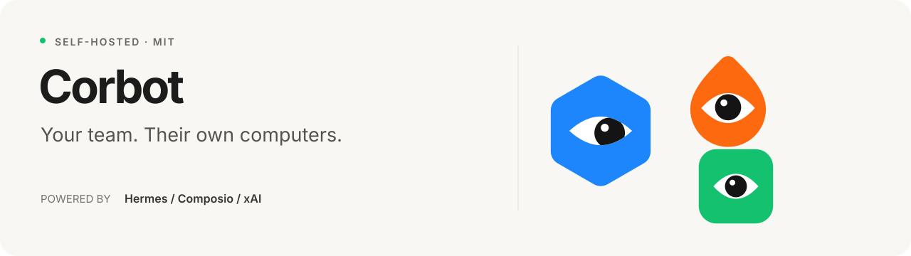
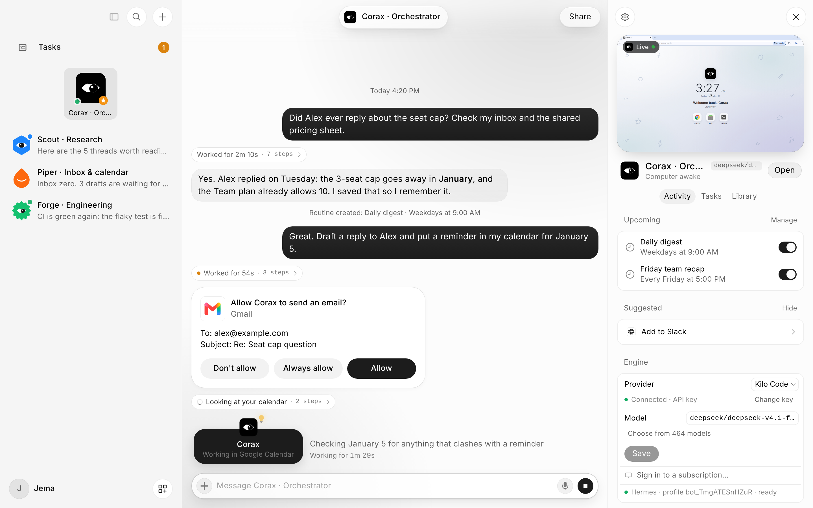
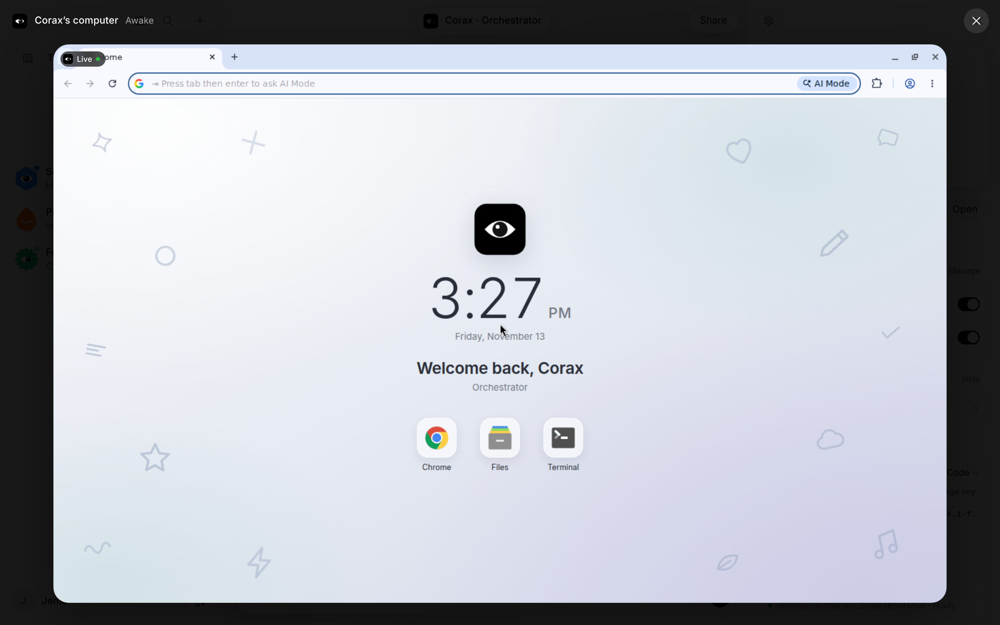
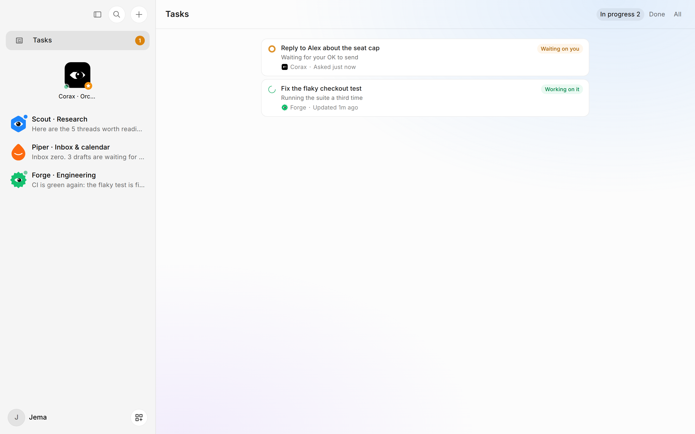
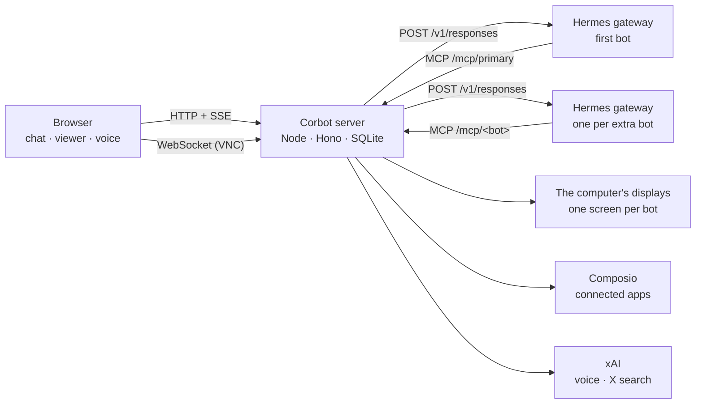

<p align="center">
  
</p>

<h1 align="center">Corbot: the ultimate agent is a team</h1>

<p align="center">
  <b>AI agents that each get their own computer, and show you every step.</b><br>
  Open source. Self-hosted. Runs on Linux and Windows, on the model subscriptions you already pay for.
</p>

<p align="center">
  <a href="#on-linux"></a>
  <a href="#on-windows"></a>
  <a href="https://github.com/JemaOS/corbot/releases/latest"></a>
  
  
</p>

<p align="center">
  <a href="#why-corbot">Why</a> ·
  <a href="#what-you-get">Features</a> ·
  <a href="#how-it-fits-together">How it works</a> ·
  <a href="#install">Install</a> ·
  <a href="docs/ARCHITECTURE.md">Architecture</a> ·
  <a href="#status-and-limits">Limits</a>
</p>

<picture>
  <source media="(prefers-color-scheme: dark)" srcset="docs/screenshots/chat-dark.png">
  <source media="(prefers-color-scheme: light)" srcset="docs/screenshots/chat-light.png">
  
</picture>

<p align="center"><sub>The screenshots follow your GitHub theme: switch between light and dark to see both. They show sample conversations.</sub></p>

---

## Why Corbot

Most agents are a chat box that says "done" and asks you to trust it. Corbot gives every agent a real desktop with a real browser, puts that screen next to the chat, and asks before it sends, posts or deletes anything in your apps.

- **You see the work.** Every step is listed as it happens, with a timer. No black box.
- **A computer per bot.** Each bot has its own screen, browser profile, files and memory. Watch it live, or take the mouse.
- **You stay in charge.** Write actions in connected apps wait for your OK on a card in the chat.
- **A team, not one bot.** Bots message each other, share a task board, and run routines on a schedule.
- **Your machine, your models.** Everything runs on a computer you own. Use Claude, ChatGPT, Grok and others through your own subscription or API keys.

### Every bot has its own screen

<picture>
  <source media="(prefers-color-scheme: dark)" srcset="docs/screenshots/screen-dark.png">
  <source media="(prefers-color-scheme: light)" srcset="docs/screenshots/screen-light.png">
  
</picture>

### One board for the whole team

<picture>
  <source media="(prefers-color-scheme: dark)" srcset="docs/screenshots/tasks-dark.png">
  <source media="(prefers-color-scheme: light)" srcset="docs/screenshots/tasks-light.png">
  
</picture>

Each bot is a [Hermes Agent](https://github.com/NousResearch/hermes-agent). [Composio](https://composio.dev) can connect their apps, and [xAI](https://x.ai) can give them a voice and research on X; both are optional.

## What you get

| | |
|---|---|
| **Chat that shows the work** | While a bot works you see what it is doing right now, how long it has been at it, and each step it took. Finished turns fold into a "Worked for 2m 10s · 7 steps" chip you can open. |
| **A screen per bot** | Every bot has its own desktop on the computer. Watch it live in the side panel, open it full size, or take control with your own mouse and keyboard. |
| **Connected apps with approvals** | With a Composio key, bots ask for the app they need and you connect it. Actions that write (send, post, delete) wait for your OK on a card in the chat. |
| **Model and subscription per bot** | Pick the provider and model in the bot's Engine panel, paste an API key there, or sign in to a subscription on the bot's own screen. |
| **Voice** | With an xAI key, talk to a bot with xAI's realtime voice modes. Real work is handed to the same bot, with the same memory and tools. |
| **Research on X** | With an xAI key, every bot has an `x_search` tool. |
| **Six languages** | English, French, Spanish, Italian, German and Portuguese. |
| **Routines, tasks and a Library** | Recurring jobs on a schedule, a task list per bot, and a place where bots save the files they make. |

## How it fits together



- **One computer, one screen per bot.** The bots live on one Linux machine: a container on your own computer. Each screen is an X display with its own VNC server; the first bot uses the main one and each further bot gets its own. The app, the agents and the screens all run there, and nothing about the screens goes through a cloud service.
- **The first bot is the Hermes agent of that computer**, installed with it.
- **Every other bot gets its own Hermes home and gateway**, started by the app. Each has its own model, sign-in, memory, browser profile and files.
- **The app's tools reach Hermes over MCP.** The server exposes `/mcp/<bot>`. Each agent gets connected apps, `x_search`, tasks, routines, the Library, and messages to other bots.
- **Screens are dressed to look like the bot's own computer**: a light desktop with a dock, and a home screen with the bot's name and apps as Chrome's new tab page.

More detail is in the [architecture guide](docs/ARCHITECTURE.md).

### How this relates to Hermes Bot Mode

Hermes Desktop has its own Bot Mode. Corbot uses the same Hermes engine but does **not** use Bot Mode: it has its own bot layer on top of the gateway's HTTP API.

| | Corbot | Hermes Bot Mode |
|---|---|---|
| A bot is | A separate Hermes home (the first bot is the default profile) | A Hermes profile |
| Gateways | One per extra bot | One, serving every profile |
| Transport | HTTP, `/v1/responses` | JSON-RPC over WebSocket |
| Routines | The app's own scheduler | Hermes cron jobs |
| Bot to bot | The app's `send_to_bot` tool | Hermes' `message_agent` tool |

So bots made here do not show up in Hermes Desktop's Bots tab, and bots made there do not show up here.

## Install

One step on a PC that has nothing yet. You need a 64-bit Intel/AMD PC, about 12 GB of free disk and an internet connection. The first install takes 10 to 30 minutes: it downloads Ubuntu, Chrome and Hermes.

| | |
|---|---|
| **Windows 10 (21H2 or newer) or 11** | [Download Corbot](https://github.com/JemaOS/corbot/releases/latest), unzip it, and double-click **`install.cmd`** |
| **Linux** | `curl -fsSL https://raw.githubusercontent.com/JemaOS/corbot/main/install.sh \| bash` or, from a copy of this repository, `./install.sh` |

The installer checks the PC, installs what is missing, sets Corbot up, adds a **Corbot** shortcut and opens the app at `http://localhost:8787`. Sign in with the email form.

One thing is left to you: **the bots need an AI model before they can answer**. In the app, open the main bot's details panel, then **Engine**, and paste an API key or sign in to a subscription (see [Models and subscriptions](#models-and-subscriptions)).

Running the installer again upgrades the app and keeps your bots and their data.

### On Linux

`install.sh` installs [LXD](https://canonical.com/lxd) if it is missing (it asks for your password for that only), creates a container named `corbot`, and builds the app inside it, so Node.js is not needed on your machine. Installing LXD was written for Ubuntu, Debian and what is built on them; on Fedora and Arch it is best effort. On another distribution, install LXD yourself and run `./install.sh` again.

Afterwards, `local/corbot` manages it:

```bash
local/corbot open        # start it if needed and open it in the browser
local/corbot deploy      # build and install the current code (after a `git pull` or a change)
local/corbot model       # choose the main bot's model from a terminal (Hermes' own setup)
local/corbot status      # what is running; also: logs, shell, stop, start
local/corbot destroy     # delete the container and everything the bots made
```

- The container (Ubuntu 24.04) holds everything: one X display per bot, Chrome, Hermes, the app and its data.
- Each screen is a TigerVNC display (`Xvnc`), so the X server and the VNC server are one process. The app's relay connects to it over a local TCP socket; the live view has no extra hop and no screen-scraping step.
- The app listens on `127.0.0.1` only. `CORBOT_PORT`, `CORBOT_SCREENS` (how many bots, default 4) and `CORBOT_SCREEN_SIZE` (default `1440x900`) change the defaults; set them when you run the installer, for example `CORBOT_PORT=9000 ./install.sh`.
- `XAI_API_KEY` and `COMPOSIO_API_KEY` are optional. Without them voice, `x_search`, connected apps and Google sign-in are switched off, and the bots are not offered those tools.
- If Docker is installed on the same machine, its firewall can cut the container off from the internet. The installer notices and prints the two commands that fix it.

### On Windows

`install.cmd` switches WSL 2 on if it is not there yet. Windows asks for permission once and the PC has to restart; **the installer carries on by itself after you sign in again**. It then creates a WSL distribution named `corbot` and builds the app inside it. Node.js, Git and Docker are not needed.

Afterwards there is a **Corbot** icon on the desktop and in the Start menu, and the bots start when you sign in to Windows. `local\corbot` has the same commands as on Linux (`open`, `deploy`, `model`, `status`, `logs`, `shell`, `stop`, `start`, `destroy`) and the same settings (set them with `$env:CORBOT_PORT = '9000'` before running the installer).

- The bots work in their own Ubuntu 24.04 distribution, separate from any other WSL distribution you have. Its disk is in `%LOCALAPPDATA%\Corbot`; `local\corbot destroy` removes it all.
- Keep the folder you installed from, on a local drive: the shortcuts point at it, and the app is built from it.
- WSL 2 needs virtualization (Intel VT-x or AMD-V) switched on in the PC's BIOS/UEFI. Most PCs have it on; the installer says so when it looks off.
- WSL stops a distribution nothing is attached to, so `start` and `open` leave one hidden process attached to keep the bots running.
- WSL's default localhost forwarding must be on (it is, unless `.wslconfig` sets `localhostForwarding=false`).
- If Windows shows "Windows protected your PC" when you open `install.cmd`, choose **More info**, then **Run anyway**: the file is not signed.
- For development, work inside WSL or on Linux: the server only runs on Linux.

### Other machines

To use another kind of machine (a VM, a Docker image), run `local/provision.sh` on it as root, then `local/install-app.sh corbot-app.tgz` with a pack from `scripts/pack.sh`. It needs systemd.

Settings are in `/opt/corbot/app/.env` inside the container; `.env.example` explains each one.

| Key | Used for |
|---|---|
| `SESSION_SECRET` | Sign-in sessions and the tokens agents use to reach `/mcp` (made at install) |
| `COMPOSIO_API_KEY` | Optional: connected apps and Google sign-in |
| `XAI_API_KEY` | Optional: voice and `x_search` |

## Models and subscriptions

Open a bot's details panel, **Engine**. Pick a provider and model there. **Sign in to a subscription** opens a terminal on the bot's screen running Hermes' own sign-in for that provider (for example Claude Pro/Max), so you finish it in the viewer and the bot uses that subscription from then on. Check your provider's terms before running an agent on a consumer subscription.

## Develop

```bash
npm run typecheck                         # server and web
node tools/i18n-check.mjs                 # every sentence translated in every language
local/corbot deploy                       # build and put the new version in the container
node tests/local-screen.mjs http://localhost:8787 <botId> <session cookie>   # the live screen, through the relay
node tests/e2e.mjs http://localhost:8787  # needs DEV_LOGIN=1, or E2E_SESSION=<session cookie>
```

The e2e suite creates a temporary bot (with its own Hermes gateway and screen), exercises chat, the browser on its screen, the live viewer, connected apps, voice sessions and settings, then deletes it. It calls real providers.

```text
server/src/         API, Hermes adapter (agent/loop.ts), engines (engine.ts), MCP endpoint (mcp.ts), screens (computer.ts)
server/box/         what runs on the computer to dress a screen (desktop, dock, home screen, Chrome)
web/src/            chat, bot settings, app connections, computer viewer, voice
install.sh, install.cmd, install.ps1   the one-step installers (Linux, Windows)
local/              the container: provision, install, the `corbot` command (`corbot.cmd` / `corbot.ps1` / `wsl.sh` on Windows)
scripts/            pack, Hermes config helper, sign-in link
tools/              translation check
tests/              Playwright end-to-end test
docs/               architecture
```

## Status and limits

- Experimental, no security audit. Bots share one computer and can reach each other's files there.
- Approval cards cover Composio write actions. What a bot does through its browser or shell is not gated, and Hermes' own "risky command" prompts are not shown in the app yet.
- As many bots as the computer has screens (`CORBOT_SCREENS`, four by default).

## License

Corbot's code is under the [MIT license](LICENSE). Some artwork and app logos belong to their own owners and are not covered by it; see [third-party notices](THIRD_PARTY_NOTICES.md).

Built with [Hermes Agent](https://github.com/NousResearch/hermes-agent) and, optionally, [Composio](https://composio.dev) and [xAI](https://x.ai). Corbot is an independent project and is not affiliated with any of them.
